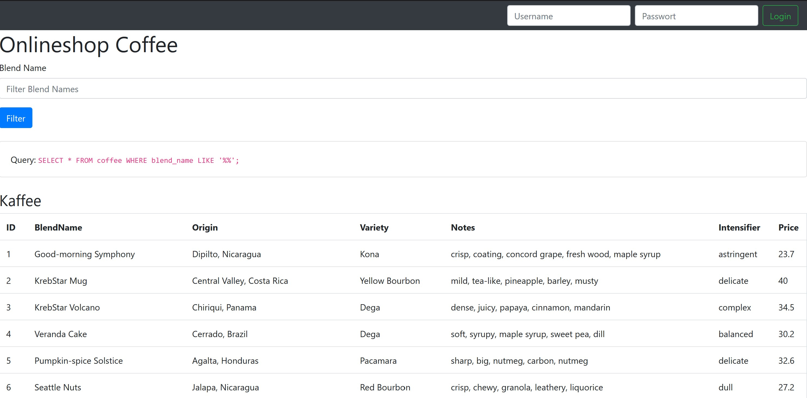

# Demo SQL Injection

<p align="center">
  <a href="#"></a>
</p>

The purpose of this mockup of a simple webshop is to demonstrate the sql injection vulnerability. In this project all database queries used are intentionally vulnerable to sql injection.

### Filter
The listed products can be filtered by the `Blend Name`. The userinput is not sanitized what makes it vulnerable for sql injections.
* sort or filter by custom attribute
* edit entries
* drop table
* drop database
* list users from other table
* ...

### Login
The login is also not protected against sql injection.
A logged in user can add items to his cart; a user with admin privileges can additionally delete items.
* login without any credentials
* login as admin
* give a user admin privileges
* ...

### Recreate initial state

At the bottom of the page, there is a button
  <span></span>, which restores a pristine db state.

## VS Code development

Install Docker with Docker Compose and the [VS Code Dev Containers extension](https://marketplace.visualstudio.com/items?itemName=ms-vscode-remote.remote-containers). Open this repository in VS Code and run **Dev Containers: Reopen in Container**.

The container includes PHP 8.5.12, MySQLi, Composer 2, Git and PHP editor support. The coffee shop starts automatically at [http://localhost:8000](http://localhost:8000). MySQL runs in a separate container and initializes the coffee and users tables on its first start.

Demo accounts:

| Username | Password | Role |
| --- | --- | --- |
| `test` | `test` | Consumer |
| `admin` | `admin` | Admin |

The development database user has privileges only on `inject_demodb`. MySQL has no published host port, and the web server binds to localhost on the host.

### Development without VS Code

Run these commands from the repository root:

```sh
docker compose -f .devcontainer/compose.yaml up --build -d --wait
docker compose -f .devcontainer/compose.yaml exec app composer install --no-interaction
```

Open [http://localhost:8000](http://localhost:8000). To open a shell or stop the containers:

```sh
docker compose -f .devcontainer/compose.yaml exec app bash
docker compose -f .devcontainer/compose.yaml down
```

The database persists across container restarts and rebuilds. Use **Recreate Table** in the shop to restore both tables and clear the current session, including after an injected `DROP DATABASE`. Reopening VS Code does not reset the data.

To discard the entire local development database and initialize it again, remove its volume:

```sh
docker compose -f .devcontainer/compose.yaml down --volumes
docker compose -f .devcontainer/compose.yaml up -d --wait
```

### Verification

Inside the development container:

```sh
php -v
composer validate --no-check-publish
composer check-platform-reqs
find . -path ./vendor -prune -o -name '*.php' -exec php -l {} \;
php tests/smoke.php
```

The smoke test exercises login, filtering, the cart, admin deletion and SQL injection examples. It drops and recreates the demo database, restoring the seed data and clearing its session at the end. Run it only against a disposable development database.

## Manual setup

Install PHP 8.5.12 or a later PHP 8.5 patch, the MySQLi extension, Composer 2 and MySQL. Run `composer install` and `composer check-platform-reqs`.

Create in mysql a new user `sql_injection` and grant him all privileges only for the database `inject_demodb`. It's important to ensure no other databases are affected by the sql injection vulnerability.

```SQL
CREATE USER 'sql_injection'@'%' IDENTIFIED BY 'foobar';
GRANT ALL PRIVILEGES ON `inject_demodb` . * TO 'sql_injection'@'%';
FLUSH PRIVILEGES;
```

Note: to be able to create a new user under dokku, check the root user:

```bash
#user:
echo root
# password:
cat /var/lib/dokku/services/mysql/app-name/ROOTPASSWORD
```

Create the Database `inject_demodb`:

```SQL
CREATE DATABASE inject_demodb;
```

The database `host`, `port`, `username` and `password` can be set over the following environment variables (in case you want to deploy it to a server):

```sh
export SQL_INJECTION_DB_HOST="localhost"
export SQL_INJECTION_DB_PORT="3306"
export SQL_INJECTION_DB_USERNAME="sql_injection"
export SQL_INJECTION_DB_PASSWORD="foobar"
```

Start `php -S localhost:8000` from the repository root and click **Recreate Table** to create and seed the `coffee` and `users` tables. The data was created with the [faker-gem](https://github.com/stympy/faker) by @stympy.


## Dokku deploy

Dokku links the app to MySQL using `DATABASE_URL`, which takes precedence over the individual `SQL_INJECTION_DB_*` variables. The URL supplies the database name and credentials; an omitted port defaults to 3306, and percent-encoded credentials are decoded.

The Composer requirement selects PHP 8.5.12 or a later PHP 8.5 patch. Before deploying, ensure the PHP buildpack installed on your Dokku host provides that runtime and MySQLi. The current [Heroku PHP buildpack runtime list](https://devcenter.heroku.com/articles/php-support#php-runtimes) includes PHP 8.5.12; older Dokku/buildpack installations may need updating. The devcontainer is for local development and does not change the Dokku deployment method.

```sh
APP='sql-injection-demo'
dokku apps:create $APP
dokku domains:set $APP sql-injection-demo.yourdomain.tld
dokku mysql:create $APP
dokku mysql:link $APP $APP

dokku config:set --no-restart $APP DOKKU_LETSENCRYPT_EMAIL=your@email.tld
dokku letsencrypt $APP

# optional expose $APP
dokku mysql:expose $APP
```
